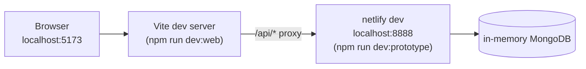
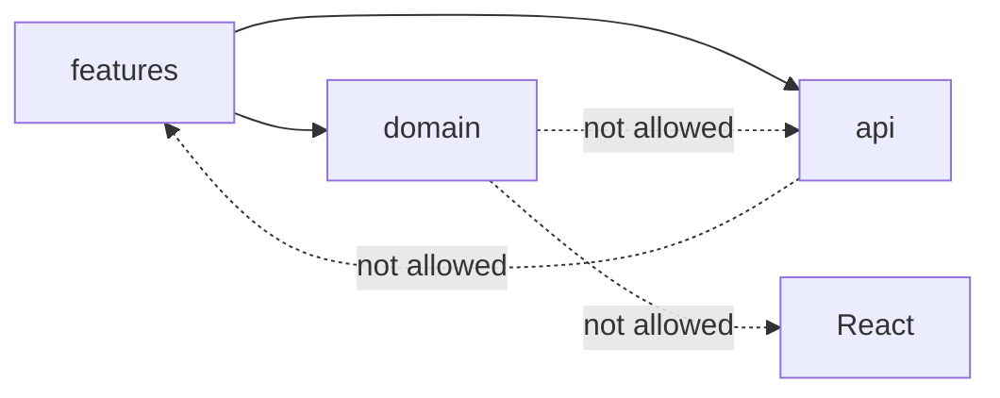

# diabe-teach web

The React web app for the Concept Chain game. It is a Vite + React 19 + TypeScript single-page app.
It calls the backend API (`/api/v1/*`, Netlify Functions) on the same origin.

The architecture is in [ADR-0008](../docs/adr/0008-simple-three-layer-ddd-react-vite-frontend.md).
The work is spec-driven: specs and tickets live in [`.scratch/react-web-ui/`](../.scratch/react-web-ui/spec.md) and [`.scratch/react-login-screen/`](../.scratch/react-login-screen/spec.md).

**Note:** As of 2026-11-25, only the teacher Login screen (`/login`) and a guarded `/setup` placeholder exist.

## Quick start

Run every command from the repository root unless the step says otherwise.

1. Use Node 24 (see `../.nvmrc`).
2. Install the backend packages: `npm install`.
3. Install the web packages: `npm --prefix web install`.
   `web/` is a standalone package with its own `package.json` and `node_modules`.
4. Start the API without the API-key check: `npm run dev:prototype`.
   Wait for the line `DEV READY http://localhost:8888`.
5. In a second terminal, start the web app: `npm run dev:web`.
6. Open <http://localhost:5173/login>.
7. Click **Create account** to make a teacher account. The in-memory database forgets it when the API stops.
8. Stop the API with `npm run dev:local:stop`. Stop Vite with `Ctrl+C`.



**Warning:** Do not put the API key in the browser. Vite copies every `VITE_*` variable into the built JavaScript, so `VITE_API_KEY` is visible to every visitor.
Use `npm run dev:prototype` for local work. The production answer is an open decision (see [Open items](#open-items)).

If you must use `npm run dev:local` (the key check is on), start Vite with the key for local use only:

```sh
VITE_API_KEY=<api_key from .env.dev.yaml> npm run dev:web
```

If the API is not running, Vite answers `/api/*` with `503 NETWORK_ERROR`. The screen then shows "Can't reach the API…". Start the API and try again.

## Commands

| Command (from the root) | What it does |
|---|---|
| `npm run dev:web` | Starts Vite on port 5173 and proxies `/api` to port 8888. |
| `npm run build:web` | Builds the app into `web/dist/`. |
| `npm run typecheck:web` | Type-checks `web/src` and `web/tests`. |
| `npm run lint:web` | Lints `web/src` and `web/tests`. The target is 0 errors and 0 warnings. |
| `npm --prefix web run lint:fix` | Fixes the lint problems that ESLint can fix. |
| `npm run lint:boundaries` | Checks the layer rules with dependency-cruiser (backend and web). |
| `npx vitest run --project web` | Runs only the web tests. |
| `npm run test` | Runs all tests: the `api` project (node) and the `web` project (jsdom). |

**Note:** `web/package.json` has no `test` script. The root Vitest config runs the web tests as the `web` project.

## How to test

### The test seam

Each test renders the real app at a route, with the real router and the real TanStack Query client.
A fake `fetch` answers each `METHOD /path` with JSON in the shape of the API contract (`docs/api/openapi.yaml`).
The test types and clicks like a teacher. Then it checks what the teacher sees, where the teacher lands, and what is left in browser storage.
The tests do not check component internals or hook calls.

```diff
 web/tests/
 ├── features/accounts/          # one file per ticket behaviour (login, refusals, sign-up, panel, guard)
 └── support/
     ├── render-app.tsx          # renderApp(path): real routes + real QueryClient in a memory router
     ├── fake-fetch.ts           # installFakeFetch({ "POST /api/v1/...": reply }) -> recorded requests
     ├── jsdom-environment.ts    # custom jsdom environment (jsdom is installed only in web/)
     └── setup.ts                # cleanup + clear localStorage and sessionStorage after each test
```

### Write a test

1. Install the fake `fetch` with one reply for each request that the screen sends.
2. Render the app at the route.
3. Act with `userEvent`. Find elements by label or role, as a screen reader does.
4. Check the screen, the route, and the storage.
5. Call `vi.unstubAllGlobals()` in `afterEach`.

```tsx
it("signs in and lands on Game Setup", async () => {
  const requests = installFakeFetch({
    "POST /api/v1/accounts/sign-in": { status: 200, body: accountTokenResponse },
    "GET /api/v1/accounts/me": { status: 200, body: instructorAccountView },
  });
  const { router } = renderApp("/login");

  await userEvent.type(screen.getByLabelText("Email"), "rahman.s@aku.edu");
  await userEvent.type(screen.getByLabelText("Password"), "correct-horse-1");
  await userEvent.click(screen.getByRole("button", { name: "Sign in" }));

  await waitFor(() => expect(router.state.location.pathname).toBe("/setup"));
  expect(localStorage.getItem("cc-account-token-v1")).not.toBeNull();
  expect(requests[0].body).toEqual({ email: "rahman.s@aku.edu", password: "correct-horse-1" });
});
```

Other fake replies:

- `"network-error"` makes `fetch` reject, as when the API is not running.
- `() => promise` holds the request pending, so you can check the disabled buttons.
- A request with no reply gets `404 NOT_FOUND`, so a missing reply fails loudly.

### Before you commit

Run the checks one at a time, not in parallel:

1. `npm run typecheck:web`
2. `npx vitest run --project web`
3. `npm run lint:web` (0 errors, 0 warnings)
4. `npm run lint:boundaries` (do not add violations)
5. `npm run build:web`

The pre-commit hook also runs `typecheck` and `typecheck:web`.

For a manual check, follow [Quick start](#quick-start) and use the screen in a browser.

## Where code goes

The app has three layers. dependency-cruiser enforces the import rules (`npm run lint:boundaries`).

```diff
 web/src/
 ├── domain/      # pure TypeScript rules: no React, no fetch, no storage      (e.g. login-errors.ts)
 ├── api/         # the ONLY place for fetch() and localStorage/sessionStorage  (http-client.ts, token stores)
 ├── features/    # React screens and components, grouped by domain area
 │   ├── accounts/       # LoginPage, useSignedInAccount
 │   ├── game-session/   # GameSetupPage (placeholder)
 │   └── shared/         # ErrorBanner, TeacherRoute + requireTeacher guard
 ├── routes.tsx   # all routes; teacher-only routes sit under the requireTeacher loader
 └── App.tsx      # router + QueryClientProvider
```



Rules:

1. Put a game rule or an error-to-sentence rule in `domain/`. Test it through the screen.
2. Send every HTTP call through `apiRequest` in `api/http-client.ts`. It adds the headers. It turns each refusal into an `ApiHttpError` with `{ status, code, message, details }`.
3. Do not use `useEffect`. ESLint refuses it. Use these instead:
   - server data and polling: `useQuery` (TanStack Query)
   - user actions: event handlers and `useMutation`
   - derived values: a pure function in `domain/`, called during render
   - storage that other tabs change: `useSyncExternalStore`
   - state reset on a phase change: a `key` prop
4. Keep the Account Token and the Capability Token apart ([ADR-0007](../docs/adr/0007-instructor-accounts-and-shared-pack-library.md)). Name the token kind when you call `apiRequest`.
5. Use the words from [`GLOSSARY.md`](../GLOSSARY.md) (Instructor Account, Account Token, Curriculum Pack, Game Session).
6. Copy the look from the prototype in `../claudPoc/concept-chain/`. `src/styles.css` comes from its `shared.css`.

## Debug

- In development, every API call logs `[API] METHOD /path -> status` in the browser console.
- In development, `ErrorBanner` shows the API error `code` next to the sentence.
- Signed-in state is in `localStorage` under `cc-account-token-v1`. Delete it to sign out.
- The one-time "why you were sent to login" message is in `sessionStorage`. The Login screen reads it once, then removes it.

## Open items

- **2026-11-25:** How the production browser passes the `x-api-key` check is not decided. Decide it before the Netlify deploy (ticket 14 in `.scratch/react-web-ui/issues/`).
- **2026-11-25:** If `GET /api/v1/accounts/me` fails with a status other than 401, the guarded page shows an `ErrorBanner` and stays. The spec does not say what to do.
