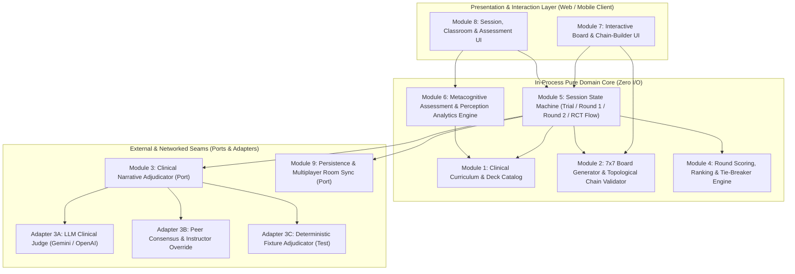

# 08 - Software Module Breakdown for Developing the Diabe-Teach Game

This research document breaks down the software modules required to develop the **Diabe-Teach** digital educational game. Every module, invariant, and seam is traced directly to the primary sources in this repository:
- **Primary Publication (`PDF`):** Shadan M, Ismail H, Naushad FHM. *"Diabe-teach: a randomized controlled trial of a gamified approach to enhance medical undergraduates’ knowledge and comprehension of diabetes mellitus."* *BMC Medical Education* (2025) 25:17, pp. 1–11 ([`papers/diabe-teach.pdf`](../papers/diabe-teach.pdf)).
- **Supplementary Material (`DOCX`):** Appendix 1 (*49 Key words used in the "Diabe-teach" game*) and Appendix 2 (*9 Survey Items*) ([`papers/supplementary_material_1.docx`](../papers/supplementary_material_1.docx)).
- **Repository Wiki Blueprints:** [`03-game-mechanics-and-rules.md`](03-game-mechanics-and-rules.md), [`04-the-49-keywords-and-clinical-domains.md`](04-the-49-keywords-and-clinical-domains.md), [`05-results-and-statistical-analysis.md`](05-results-and-statistical-analysis.md), and [`07-digital-implementation-architecture.md`](07-digital-implementation-architecture.md).

Following the repo's [`codebase-design`](../.agents/skills/codebase-design/SKILL.md) principles, the architecture is organized into **deep modules**—modules that pack substantial domain behavior, clinical rules, and state invariants behind small, testable **interfaces** placed at clean **seams**.

---

## 1. High-Level Module Architecture & Dependency Graph



---

## 2. Deep Module Breakdown

### Module 1: Clinical Curriculum & Deck Catalog (`curriculum-catalog`)

- **Purpose:** Owns the canonical immutable dataset of the 49 diabetes mellitus keywords, their clinical definitions, their 7 semantic domain clusters, the 5-option pretest/post-test MCQ bank (including the mandatory *"I don't know"* metacognitive option), and the 9-item Likert feedback questionnaire.
- **Primary Source Citations:**
  - `papers/supplementary_material_1.docx` (Appendix 1): Verbatim list of 49 keywords (`Insulin`, `Glucose`, `LADA`, `Hyperglycaemia`, `Keto-acidosis`, `Glucosuria`, `Glycemic index`, `Sulfonyl-ureas`, `Dys-lipidaemia`, `Pancreas`, `Amylin`, `Genetic`, `Smoking`, `Microalbuminuria`, `Diet`, `HbA1c`, `MODY`, `Hypo-glycemia`, `Adiponectin`, `Glipizide`, `Beta cells`, `C-Peptide`, `Retinopathy`, `Polyuria`, `Ulcer`, `Gastro-paresis`, `Podiatrist`, `Metformin`, `Lipo-hypertrophy`, `Screening`, `Polydipsia`, `GTT`, `Thiazolidine-diones`, `Autoimmune`, `Venous`, `ACE Inhibitors`, `Neuropathy`, `Glucagon`, `Polyphagia`, `Weight loss`, `Glucometer`, `Pregnancy`, `Weight`, `Hypertension`, `Islet Cells`, `Transplant`, `HHS`, `Fasting`, `Children`).
  - `papers/supplementary_material_1.docx` (Appendix 2) & `papers/diabe-teach.pdf` (p. 5, *Feedback collection*; Fig. 3, p. 7): The 9 validated 5-point Likert items (`1 = highly disagree` to `5 = highly agree`, Cronbach's $\alpha = 0.81$).
  - `papers/diabe-teach.pdf` (p. 5, *Data collection*): 10 MCQs at Bloom's Taxonomy cognitive levels 2 (Comprehension) and 3 (Application), each having 5 options: 1 correct answer, 3 plausible distractors, and 1 *"I don't know"* option.
  - `wiki/04-the-49-keywords-and-clinical-domains.md` (lines 11–95): Clinical definitions and 7 domain clusters (*Anatomy & Pathophysiology*, *Disease Subtypes & Genetics*, *Cardinal Signs & Symptoms*, *Acute Metabolic Crises*, *Diagnostic & Monitoring Tools*, *Therapeutics & Multidisciplinary*, *Complications & Risk Factors*).
- **Interface:**
  ```typescript
  export type ClinicalDomain =
    | "anatomy-pathophysiology"
    | "subtypes-genetics"
    | "signs-symptoms"
    | "acute-crises"
    | "diagnostics-monitoring"
    | "therapeutics-multidisciplinary"
    | "complications-risk-factors";

  export interface KeywordCard {
    readonly id: string;
    readonly label: string; // Exact string from Appendix 1
    readonly domain: ClinicalDomain;
    readonly clinicalSummary: string;
  }

  export interface AssessmentQuestion {
    readonly id: string;
    readonly bloomLevel: 2 | 3;
    readonly stem: string;
    readonly options: readonly [string, string, string, string]; // 1 correct + 3 distractors
    readonly correctIndex: 0 | 1 | 2 | 3;
    readonly relatedKeywordIds: readonly string[];
  }

  export interface CurriculumCatalog {
    getDeck(): readonly KeywordCard[]; // Always length 49
    getKeywordById(id: string): KeywordCard | undefined;
    getAssessmentBank(): readonly AssessmentQuestion[]; // 10 MCQs + implicit "I don't know"
    getSurveyItems(): readonly { id: string; prompt: string }[]; // 9 Likert items
  }
  ```
- **Hidden Complexity / Implementation:**
  - Enforces the invariant that a deck contains **exactly 49 distinct keywords** matching Appendix 1 (`papers/diabe-teach.pdf`, p. 4).
  - Normalizes spelling variants present across the paper's body text vs. Appendix 1 (e.g., `Lipohypertrophy` vs. `Lipo-hypertrophy` vs. `lipodistrophy` in Fig. 2 caption, p. 4; `Hyperglycemia` vs. `Hyperglycaemia`).
- **Dependency Category & Seam:** In-process, pure data/computation. Zero external dependencies; tested directly through its interface.

---

### Module 2: 7×7 Board Generator & Topological Chain Validator (`board-topology-engine`)

- **Purpose:** Generates reproducible (seedable) 7×7 boards from the 49-card deck and validates whether any proposed sequence of grid cells satisfies the physical board rules of Diabe-teach.
- **Primary Source Citations:**
  - `papers/diabe-teach.pdf` (p. 4, *Game mechanics* & Fig. 2):
    - *"These cards were shuffled and arranged in a 7×7 grid format on the table before the game began."*
    - *"construct chains of at least four 'connected' keywords. For a chain to be valid, each keyword had to touch the next keyword either horizontally or diagonally (Fig. 2)."*
    - *"After the trial round, the cards comprising the game board were reshuffled and rearranged into a new 7×7 grid format to ensure a fair start for the actual game."*
    - Fig. 2 Chain C invalidity rule: *"Chain C: 'Autoimmune' (destruction of) 'islet cells' (in) 'pancreas' (cause diabetes that has complications) and 'retinopathy'. As the keywords 'pancreas' and 'islet cells' do not touch each other, the chain was considered invalid."*
  - `wiki/03-game-mechanics-and-rules.md` (lines 25–35, 45–84) & `wiki/07-digital-implementation-architecture.md` (lines 31–87):
    - 8-directional king-move adjacency (Chebyshev distance $\max(|r_1 - r_2|, |c_1 - c_2|) = 1$), uniqueness of visited cells in a single chain, and minimum chain length $N \ge 4$.
    - Note on Figure 2 (`papers/diabe-teach.pdf`, p. 4): In Chain A (`Genetic [3,4]` $\to$ `Smoking [3,3]` $\to$ `Weight [4,4]` $\to$ `Insulin [4,3]` $\to$ `Microalbuminuria [3,2]` $\to$ `Screening [3,1]` $\to$ `Neuropathy [4,1]` $\to$ `Gastroparesis [5,1]` $\to$ `Lipohypertrophy [6,1]`), transitions include horizontal (`[3,4] -> [3,3]`), diagonal (`[3,3] -> [4,4]`), and vertical (`[3,1] -> [4,1] -> [5,1] -> [6,1]`) steps—all captured cleanly by Chebyshev distance $= 1$.
- **Interface:**
  ```typescript
  export interface GridCoord {
    readonly row: number; // 0..6
    readonly col: number; // 0..6
  }

  export interface BoardCell extends GridCoord {
    readonly card: KeywordCard;
  }

  export interface BoardGrid {
    readonly seed: string;
    readonly cells: readonly (readonly BoardCell[])[]; // 7x7 matrix
    getCell(coord: GridCoord): BoardCell;
    findCardCoord(keywordId: string): GridCoord | undefined;
  }

  export type TopologyValidationResult =
    | { readonly valid: true; readonly resolvedCards: readonly BoardCell[] }
    | {
        readonly valid: false;
        readonly reason:
          | "CHAIN_TOO_SHORT" // < 4 cards
          | "OUT_OF_BOUNDS" // row/col outside 0..6
          | "DUPLICATE_CELL" // revisiting same card in one chain
          | "NON_ADJACENT_TRANSITION"; // Chebyshev distance != 1
        readonly brokenTransitionIndex?: number;
        readonly message: string;
      };

  export function createBoard(deck: readonly KeywordCard[], seed?: string): BoardGrid;
  export function validateChainTopology(
    board: BoardGrid,
    path: readonly GridCoord[]
  ): TopologyValidationResult;
  export function getValidNextNeighbors(
    board: BoardGrid,
    currentPath: readonly GridCoord[]
  ): readonly GridCoord[];
  ```
- **Hidden Complexity / Implementation:**
  - Deterministic PRNG shuffling (e.g., Mulberry32/xoshiro seeded by `seed`) so all students in a classroom multiplayer session receive the **exact same 7×7 arrangement** (`wiki/07-digital-implementation-architecture.md`, line 129), and so the Fig. 2 canonical board from the paper can be loaded deterministically for the 15-minute orientation/trial round (`papers/diabe-teach.pdf`, p. 4).
  - Optional domain-balanced shuffle constraint (preventing all 7 cards of a single clinical domain from clustering into an isolated corner while preserving uniform randomness).
  - $O(N)$ path verification checking bounds ($0 \le r, c < 7$), uniqueness (`Set` of coordinates), minimum length ($\ge 4$), and Chebyshev distance ($\max(|\Delta r|, |\Delta c|) = 1$), plus helper `getValidNextNeighbors` to power UI highlighting of legal next cards during drag/tap selection.
- **Dependency Category & Seam:** In-process, pure mathematical/graph module. Tested directly with property-based and example-based tests (including exact tests for Figure 2's Valid Chain A [length 9], Valid Chain B [length 7], and Invalid Chain C [broken adjacency between `Islet Cells` at `(2,0)` and `Pancreas` at `(0,1)`]).

---

### Module 3: Clinical Narrative Adjudicator (`clinical-adjudicator`)

- **Purpose:** Evaluates whether a topologically valid chain of $\ge 4$ keywords is accompanied by a medically accurate, pathophysiologically continuous rationale connecting each keyword transition ($C_0 \to C_1 \to \dots \to C_{n-1}$).
- **Primary Source Citations:**
  - `papers/diabe-teach.pdf` (p. 4–5, *Game mechanics*):
    - *"The participants were required to explain each chain at the end of the round."*
    - *"Approval of the connecting chains was subject to consensus among team members, with any ambiguities resolved by the instructor, whose decision was considered final."*
  - `wiki/03-game-mechanics-and-rules.md` (lines 36–39, 93–96):
    - *"Merely touching adjacent cards is insufficient. For every transition in the chain ($A \to B \to C \to D$), the player must articulate a legitimate, medically sound rationale explaining how $A$ leads to, interacts with, diagnoses, treats, or complicates $B$, and so on."*
  - `wiki/07-digital-implementation-architecture.md` (lines 91–118):
    - LLM Clinical Verification prompt evaluating pathophysiological/pharmacological/diagnostic accuracy, pairwise continuity from term $i$ to term $i+1$, and clinical plausibility.
- **Interface (Port at the Seam):**
  ```typescript
  export interface ChainSubmission {
    readonly chainId: string;
    readonly playerId: string;
    readonly keywords: readonly KeywordCard[]; // Ordered sequence (>= 4)
    readonly narrativeExplanation: string; // Student's written/transcribed clinical rationale
  }

  export interface TransitionEvaluation {
    readonly fromKeywordId: string;
    readonly toKeywordId: string;
    readonly isClinicallySound: boolean;
    readonly commentary: string;
  }

  export interface AdjudicationVerdict {
    readonly chainId: string;
    readonly isApproved: boolean;
    readonly adjudicatorType: "ai-endocrinologist" | "peer-consensus" | "instructor-final";
    readonly qualityScore: number; // 1..10
    readonly transitionEvaluations: readonly TransitionEvaluation[];
    readonly overallFeedback: string;
    readonly suggestedRefinements?: string;
  }

  export interface ClinicalAdjudicatorPort {
    adjudicateChain(submission: ChainSubmission): Promise<AdjudicationVerdict>;
  }
  ```
- **Adapters at this Seam:**
  1. **`LlmClinicalAdjudicatorAdapter` (True External / Remote):** Calls an LLM (e.g., Gemini / OpenAI) with structured JSON schema output, grounded with the official clinical summaries from Module 1 so it evaluates pairwise transitions strictly against undergraduate endocrinology standards (`wiki/07-digital-implementation-architecture.md`, lines 95–118).
  2. **`HumanConsensusAdjudicatorAdapter` (Classroom / Peer + Instructor Mode):** Models the exact RCT classroom workflow (`papers/diabe-teach.pdf`, p. 5) where peers vote to approve/challenge a presented chain during the 10-minute presentation phase, and any disputed chain is escalated to the supervising instructor whose override is final.
  3. **`InMemoryRuleAdjudicatorAdapter` (Test Stand-In):** Deterministic fake used in automated tests (pre-configured with known valid/invalid narratives such as Figure 2 Chains A & B vs. nonsensical rationales).
- **Hidden Complexity / Implementation:**
  - Rejects superficial "keyword listing" where a student simply repeats the card names without stating the causal, diagnostic, or therapeutic mechanism linking them.
  - Evaluates **every consecutive pair** ($k_i \to k_{i+1}$) so feedback pinpoints the exact weak link in a long chain rather than returning an opaque pass/fail.

---

### Module 4: Round Scoring, Ranking & Tie-Breaker Engine (`round-scoring-engine`)

- **Purpose:** Computes round standings and declares round/session winners from the set of adjudicated chains according to the exact RCT rules.
- **Primary Source Citations:**
  - `papers/diabe-teach.pdf` (p. 5, *Game mechanics*):
    - *"The winner was determined by the participant with the longest chain, and in cases of ties, the participant with the maximum number of chains was declared the winner."*
  - `wiki/03-game-mechanics-and-rules.md` (lines 87–96) & `wiki/07-digital-implementation-architecture.md` (line 24, 132).
- **Interface:**
  ```typescript
  export interface EvaluatedPlayerChain {
    readonly chainId: string;
    readonly playerId: string;
    readonly path: readonly GridCoord[]; // Must be topologically valid (length >= 4)
    readonly verdict: AdjudicationVerdict; // Must have isApproved === true to count
  }

  export interface PlayerRoundStanding {
    readonly rank: number; // 1-indexed (shared rank only if both longest & total count tie)
    readonly playerId: string;
    readonly longestValidChainLength: number; // Primary sort key (descending)
    readonly totalValidChainsCount: number; // Secondary tie-breaker key (descending)
    readonly cumulativeRationaleScore: number; // Tertiary digital tie-breaker / analytics metric
    readonly validChains: readonly EvaluatedPlayerChain[];
    readonly rejectedChains: readonly EvaluatedPlayerChain[];
  }

  export function rankRoundStandings(
    playerIds: readonly string[],
    submissions: readonly EvaluatedPlayerChain[]
  ): readonly PlayerRoundStanding[];
  ```
- **Hidden Complexity / Implementation:**
  - Filters out chains that failed topological validation (`length < 4` or non-adjacent) or failed clinical adjudication (`verdict.isApproved === false`).
  - Deduplicates identical coordinate paths submitted multiple times by the same player within the same round so a player cannot inflate their tie-breaker count (`totalValidChainsCount`) by submitting trivial re-submissions of the same path.
  - Strictly enforces the primary rule (`longestValidChainLength` descending) followed by the secondary tie-breaker (`totalValidChainsCount` descending).
- **Dependency Category & Seam:** In-process, pure function. Zero I/O; 100% unit-testable with edge cases (ties in longest chain broken by total chain count, players with zero valid chains, duplicate chain filtering).

---

### Module 5: Session & Round Lifecycle State Machine (`session-orchestrator`)

- **Purpose:** Orchestrates the timed phases of a Diabe-teach session—supporting both the full 2-hour RCT protocol and standalone gameplay rounds (Orientation/Trial Round $\to$ Round 1 $\to$ Round 2), including the 20-minute chain-building phase and 10-minute explanation/adjudication phase per round.
- **Primary Source Citations:**
  - `papers/diabe-teach.pdf` (pp. 3–4, *Session timeline*, Fig. 1, & *Game mechanics*):
    - **Pretest (15 min):** 10 MCQs assessing baseline knowledge.
    - **Intervention (75 min):**
      - *Orientation & Trial Round (15 min):* Practice forming chains and explaining connections with instructor guidance; board is reshuffled afterward so familiarity gives no unfair advantage.
      - *Game Round 1 (30 min):* Freshly shuffled 7×7 grid. First **20 min**: analyze grid, form chains, record connections. Last **10 min**: explain chains to peers and receive instructor feedback/adjudication.
      - *Game Round 2 (30 min):* Full reshuffle into a new 7×7 grid; 20 min chain formation + 10 min explanation/adjudication.
    - **Post-test (15 min):** Identical 10 MCQs immediately following the intervention.
    - **Feedback Collection (15 min):** 9-item anonymous Likert questionnaire.
- **Interface:**
  ```typescript
  export type SessionMode =
    | "solo-practice" // Single round (customizable timer, AI adjudication)
    | "classroom-game" // Trial (15m) + Round 1 (20m+10m) + Round 2 (20m+10m)
    | "full-rct-protocol"; // Pretest (15m) -> Classroom Game (75m) -> Posttest (15m) -> Survey (15m)

  export type RoundSubPhase =
    | "chain-mapping" // 20 minutes: players inspect 7x7 grid and record chains + rationales
    | "peer-adjudication" // 10 minutes: verbal/written presentation, peer challenge & instructor/AI ruling
    | "round-summary"; // Standings & winner declaration

  export interface GameSessionState {
    readonly sessionId: string;
    readonly mode: SessionMode;
    readonly currentPhase:
      | { readonly kind: "pretest"; readonly endsAtMs: number }
      | { readonly kind: "trial-orientation"; readonly board: BoardGrid; readonly endsAtMs: number }
      | {
          readonly kind: "gameplay-round";
          readonly roundNumber: 1 | 2;
          readonly subPhase: RoundSubPhase;
          readonly board: BoardGrid;
          readonly draftChainsByPlayer: ReadonlyMap<string, readonly ChainSubmission[]>;
          readonly adjudicatedChains: readonly EvaluatedPlayerChain[];
          readonly endsAtMs: number;
        }
      | { readonly kind: "posttest"; readonly endsAtMs: number }
      | { readonly kind: "feedback-survey"; readonly endsAtMs: number }
      | { readonly kind: "completed" };
  }
  ```
- **Hidden Complexity / Implementation:**
  - Enforces the **reshuffle invariant** (`papers/diabe-teach.pdf`, p. 4): transitioning from `trial-orientation` to `gameplay-round (1)` and from `gameplay-round (1)` to `gameplay-round (2)` must generate a freshly shuffled 7×7 `BoardGrid` with a new seed.
  - Locks chain creation when a round transitions from `chain-mapping` (20 min) to `peer-adjudication` (10 min), ensuring players can only present chains recorded before the mapping timer expired.
  - Accepts an injected clock (`nowMs()`) so all 15m / 20m / 10m timer transitions can be tested deterministically in milliseconds without `sleep`.

---

### Module 6: Metacognitive Assessment & Perception Analytics Engine (`assessment-analytics-engine`)

- **Purpose:** Scores the 10-question pretest/post-test assessments while separating **correct responses**, **wrong guesses (commission errors)**, and **"I don't know" responses (metacognitive gap recognition)**, and computes study-grade learning analytics (knowledge gain, uncertainty calibration, domain coverage heatmaps, and Likert survey distributions).
- **Primary Source Citations:**
  - `papers/diabe-teach.pdf` (p. 5, *Data collection*; p. 6, Table 1 & Table 2):
    - *"Each MCQ had 5 options: one correct answer, 3 distractors and one 'I don't know' option to mitigate forced guessing. These responses were recorded separately and excluded from the calculation of test scores, but their frequency was analysed independently to evaluate self-awareness."*
    - Table 1 & Table 2 key empirical findings: Intervention post-test achieved $81.8\%$ correct (vs. $68.9\%$ control, $p < 0.001$), reduced wrong guesses to $9.3\%$ (vs. $25.7\%$ control, $p < 0.001$), and maintained higher *"I don't know"* selection when uncertain ($8.9\%$ vs. $5.4\%$ control, $p < 0.001$).
  - `wiki/07-digital-implementation-architecture.md` (lines 138–143):
    - **Chain Diversity Index** (cross-domain bridging across the 7 clinical clusters), **Uncertainty Calibration** (ratio of admitted `"I don't know"` responses to erroneous guesses), and **7×7 Board Path Heatmaps** (identifying overlooked keywords/domains for faculty).
- **Interface:**
  ```typescript
  export type McqAnswerChoice = 0 | 1 | 2 | 3 | "I_DONT_KNOW";

  export interface AssessmentAttemptSummary {
    readonly playerId: string;
    readonly stage: "pretest" | "posttest";
    readonly correctCount: number;
    readonly wrongGuessCount: number;
    readonly iDontKnowCount: number;
    readonly correctPercentage: number; // 0..100
    readonly wrongGuessPercentage: number; // 0..100
    readonly iDontKnowPercentage: number; // 0..100
    readonly uncertaintyCalibrationRatio: number; // iDontKnowCount / (iDontKnowCount + wrongGuessCount)
  }

  export interface LearnerMetacognitiveReport {
    readonly playerId: string;
    readonly pretest?: AssessmentAttemptSummary;
    readonly posttest?: AssessmentAttemptSummary;
    readonly knowledgeGainDelta?: number; // posttest.correctPercentage - pretest.correctPercentage
    readonly guessingReductionDelta?: number; // pretest.wrongGuessPercentage - posttest.wrongGuessPercentage
    readonly chainDiversityIndex: number; // 0..1 Shannon/Simpson diversity across the 7 clinical domains
    readonly neglectedKeywordIds: readonly string[]; // Keywords present on board but never chained
  }

  export function scoreAssessmentAttempt(
    questions: readonly AssessmentQuestion[],
    answers: ReadonlyMap<string, McqAnswerChoice>
  ): AssessmentAttemptSummary;
  ```
- **Hidden Complexity / Implementation:**
  - Strictly preserves the distinction between **unanswered**, **wrong distractor chosen**, and **explicit `"I_DONT_KNOW"` chosen** (`papers/diabe-teach.pdf`, p. 5–6).
  - Computes cross-domain transition matrices from a student's valid chains (e.g., whether the student bridges *Disease Subtypes & Genetics* $\to$ *Diagnostics* $\to$ *Therapeutics* or stays inside a single cluster) and flags curriculum blind spots.
- **Dependency Category & Seam:** In-process, pure analytical module. Tested directly with synthetic cohort datasets and verified against Table 1 numbers from `papers/diabe-teach.pdf` (p. 6).

---

### Module 7: Interactive 7×7 Board & Chain-Builder UI (`board-chain-ui`)

- **Purpose:** Renders the tactile 7×7 keyword grid, supports drag/tap sequential card chaining with live Chebyshev adjacency feedback, displays numbered path overlays (matching Figure 2 of the paper), and captures the student's step-by-step or narrative clinical explanation.
- **Primary Source Citations:**
  - `papers/diabe-teach.pdf` (p. 4, Fig. 2; p. 7, Fig. 3; p. 9, *Discussion*):
    - Figure 2 visual representation: 7×7 card grid with numbered directional links (`1 -> 2 -> ... -> 9`) and color-coded valid/invalid chain paths.
    - Stress-free UX requirement (p. 6 & Fig. 3): $0\%$ of students reported feeling stressed or anxious, and $99\%$ found the rules easy to understand and simple to follow.
  - `wiki/07-digital-implementation-architecture.md` (lines 10–15).
- **Interface (Component / View-Model Contract):**
  - **Inputs:** `BoardGrid`, current `RoundSubPhase`, remaining timer, list of already-recorded chains in the current round.
  - **User Actions:**
    - Tap/drag across cells to build a candidate chain (`currentPath: GridCoord[]`).
    - Auto-highlight legal next adjacent neighbors (`ChebyshevDistance === 1` and not yet in `currentPath`) while dimming non-adjacent cells to prevent accidental invalid topology like Figure 2 Chain C.
    - Enter clinical rationale text (either as a unified paragraph or per-transition step $C_i \to C_{i+1}$) and save to round sheet once `currentPath.length >= 4`.
    - Inspect keyword definition drawer (only enabled during `trial-orientation` or post-round review, disabled during competitive rounds).

---

### Module 8: Classroom Facilitator, Peer Review & Assessment UI (`session-classroom-ui`)

- **Purpose:** Provides the multi-phase user experience surrounding the board: the 15-minute Pretest/Post-test MCQ runner (with prominent *"I don't know"* option), the 10-minute Peer Presentation & Instructor Adjudication screen, the live Round Leaderboard, and the 9-item Likert Feedback Survey.
- **Primary Source Citations:**
  - `papers/diabe-teach.pdf` (pp. 3–7, Fig. 1, Table 1, Fig. 3) & `papers/supplementary_material_1.docx` (Appendix 2).
- **Key Sub-Views:**
  1. **Assessment Runner View:** Presents the 10 MCQs with the 5th option (*"I don't know — I recognize this is a gap in my current knowledge"*) styled neutrally so learners are not psychologically pressured into blind guessing.
  2. **10-Minute Peer Presentation & Adjudication View:** Steps through each submitted chain overlaid on the 7×7 board, displays the student's rationale, allows peers to vote/comment, and provides the Instructor Final Ruling toggle (or triggers AI Endocrinologist adjudication in solo/auto mode).
  3. **Round Winner & Analytics Dashboard:** Displays longest valid chain winner, tie-breaker chain counts, and post-session metacognitive calibration charts.

---

### Module 9: Persistence & Classroom Room Sync (`session-persistence-sync`)

- **Purpose:** Persists game sessions, board seeds, submitted chains, adjudication verdicts, and pre/post-test telemetry, and synchronizes room phase transitions across connected players in classroom multiplayer mode.
- **Primary Source Citations:**
  - `wiki/07-digital-implementation-architecture.md` (lines 17–26, 128–135).
- **Interface (Port at the Seam):**
  ```typescript
  export interface SessionRepositoryPort {
    saveSession(state: GameSessionState): Promise<void>;
    loadSession(sessionId: string): Promise<GameSessionState | undefined>;
    subscribeToRoom(
      sessionId: string,
      onUpdate: (state: GameSessionState) => void
    ): () => void;
  }
  ```
- **Adapters at this Seam:**
  1. **`InMemorySessionRepository` / `LocalStorageSessionRepository`:** Enables zero-backend offline solo play, pass-and-play tabletop tablet mode, and fast integration testing.
  2. **`RealtimeClassroomRepository` (WebSocket / Supabase / Firebase):** Synchronizes room codes, shared board seeds, 20m/10m phase timers, and live peer adjudication across a classroom cohort.

---

## 3. Summary Matrix: Modules vs. Primary Source Mandates

| # | Module | Category | Primary Source Basis | Key Invariant Hidden Inside Module |
|---|---|---|---|---|
| **M1** | `curriculum-catalog` | In-process (Pure) | `supplementary_material_1.docx` (App. 1 & 2); `diabe-teach.pdf` p. 4–5 | Exactly 49 canonical keywords across 7 clinical domains; 5-option MCQs with `"I don't know"`; 9 Likert items |
| **M2** | `board-topology-engine` | In-process (Pure) | `diabe-teach.pdf` p. 4, Fig. 2; `wiki/03`, `wiki/07` | $7 \times 7$ unique placement; chain length $\ge 4$; unique cells; consecutive Chebyshev distance $= 1$ |
| **M3** | `clinical-adjudicator` | Port + 3 Adapters | `diabe-teach.pdf` p. 4–5; `wiki/03`, `wiki/07` | Pairwise clinical & pathophysiological continuity across every step $C_i \to C_{i+1}$ |
| **M4** | `round-scoring-engine` | In-process (Pure) | `diabe-teach.pdf` p. 5; `wiki/03` | Winner = longest approved chain; tie-breaker = max count of distinct approved chains |
| **M5** | `session-orchestrator` | In-process State Machine | `diabe-teach.pdf` p. 3–4, Fig. 1; `wiki/02` | Mandatory deck reshuffle between Trial (15m), Round 1 (20m+10m), and Round 2 (20m+10m) |
| **M6** | `assessment-analytics-engine` | In-process (Pure) | `diabe-teach.pdf` p. 5–6, Tables 1–2; `wiki/05`, `wiki/07` | `"I don't know"` tracked separately from wrong guesses; metacognitive calibration & domain diversity |
| **M7** | `board-chain-ui` | Frontend View | `diabe-teach.pdf` p. 4, Fig. 2, Fig. 3 | Interactive 7×7 grid with live neighbor highlighting and numbered chain path overlays |
| **M8** | `session-classroom-ui` | Frontend View | `diabe-teach.pdf` p. 3–7; `supplementary_material_1.docx` App. 2 | Pre/post-test runner, 10m peer/instructor review workflow, and 9-item Likert survey |
| **M9** | `session-persistence-sync` | Port + 2 Adapters | `wiki/07` lines 17–26, 128–135 | Shared board seed & phase clock synchronization across classroom participants |

---

## 4. Recommended Implementation Order

1. **Phase 1 — Pure Domain Core (M1, M2, M4):**
   - Implement `curriculum-catalog` (all 49 keywords from Appendix 1 + 9 survey items from Appendix 2), `board-topology-engine` (7×7 seeded shuffle + Chebyshev path validator), and `round-scoring-engine` (longest chain + total chains tie-breaker).
   - Verify with deterministic unit tests reproducing Figure 2 (`papers/diabe-teach.pdf`, p. 4): Valid Chain A (9 cards), Valid Chain B (7 cards), and Invalid Chain C (`Islet Cells` $\not\leftrightarrow$ `Pancreas`).
2. **Phase 2 — Session State Machine & Adjudication Seam (M3, M5, M6):**
   - Implement `session-orchestrator` (Trial 15m $\to$ Round 1 [20m mapping + 10m review] $\to$ Round 2 [20m mapping + 10m review]), `clinical-adjudicator` port with `InMemoryRuleAdjudicatorAdapter` and `HumanConsensusAdjudicatorAdapter`, and `assessment-analytics-engine`.
3. **Phase 3 — Interactive Board & Classroom UI (M7, M8) + Local Persistence (M9 Local Adapter):**
   - Build the playable 7×7 web application supporting Solo Practice Mode and Pass-and-Play / Instructor-Facilitated Classroom Mode.
4. **Phase 4 — AI Endocrinologist Judge & Multiplayer Classroom Sync (M3 LLM Adapter, M9 Realtime Adapter):**
   - Wire `LlmClinicalAdjudicatorAdapter` for instant clinical rationale grading and `RealtimeClassroomRepository` for synchronous multi-device cohort sessions.
