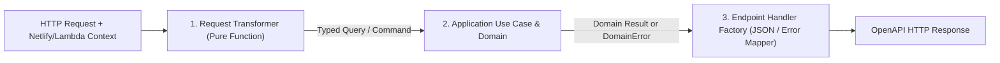

# 11 - Simple Factory & Request-Transformer Pattern for Hexagonal HTTP Handlers

Dated research and design note (**2026-10-24**) on simplifying Hexagonal Driving Adapters using a **Request Transformer + Endpoint Handler Factory** pipeline (`HTTP Input -> Transformer -> Use Case / Domain -> Response`).

---

## 1. Problem: Boilerplate in Per-Endpoint Driving Adapters

When building 14serverless endpoints on Netlify Functions v2 / AWS Lambda, writing standalone imperative handler functions leads to repeated boilerplate in every file:
- Extracting path parameters from `context.params` vs. `request.url`
- Parsing `Authorization: Bearer <token>` headers
- Wrapping execution in `try / catch (error)` blocks
- Mapping `DomainError` subclasses (`PackNotFoundError`, `UnauthorizedTokenError`, etc.) to OpenAPI `ApiErrorResponse` JSON payloads and HTTP status codes
- Constructing `new Response(JSON.stringify(result), { status, headers })`

When all of those responsibilities are mixed inside each endpoint handler, code reviews have to re-verify error mapping and HTTP plumbing on every single route.

---

## 2. Primary-Source Architectural Pattern: Transformer + Factory Pipeline

In Alistair Cockburn's **Hexagonal Architecture (Ports & Adapters)** and Martin Fowler's **Enterprise Application Architecture** (*Data Transfer Object / Mapper / Service Layer*), a Driving Adapter has exactly one job:
1. **Transform** the external transport input (`Request` + serverless `RouteContext`) into a typed Application/Domain input (`TQuery` / `TCommand`).
2. **Invoke** the inbound Driving Port (`UseCase.execute(query)`).
3. **Present** the domain output (or `DomainError`) as a transport `Response`.

By separating the **Request Transformer** from the **Execution Pipeline Factory**, every endpoint becomes a small, declarative configuration:



### The Three Building Blocks

1. **Shared Endpoint Handler Factory (`createEndpointHandler<TQuery, TResult>`)**:
   - Lives in `src/adapters/driving/http/endpoint-handler.factory.ts`.
   - Centralizes the 3-step pipeline (`transformRequest` $\to$ `execute` $\to$ `jsonResponse` / `mapDomainErrorToResponse`) so `try/catch`, status codes, and JSON headers are written **once** for the entire codebase.
2. **Per-Endpoint Request Transformer (`transform<Endpoint>Request`)**:
   - A small, pure function: `(input: HttpRequestInput) => TQuery`.
   - Uses shared one-line helpers (`requirePathParam`, `extractBearerToken`) to turn raw HTTP inputs into the exact `Query` or `Command` expected by the Application Use Case.
3. **Per-Endpoint Handler Factory (`create<Endpoint>Handler(deps)`)**:
   - A 10-line factory that instantiates the Use Case with injected Driven Ports (`deps`) and passes `{ transformRequest, execute }` to `createEndpointHandler`.

---

## 3. Code Example (`GET /api/v1/packs/:packId`)

```typescript
// 1. Pure Request Transformer: HTTP -> Application Query
export function transformGetPackByIdRequest({
  request,
  context,
}: HttpRequestInput): GetCurriculumPackByIdQuery {
  return {
    packId: resolvePackIdFromContextOrUrl(request, context),
    bearerToken: parseBearerTokenHeader(request.headers.get("authorization")),
  };
}

// 2. Simple Factory: wires Transformer -> Use Case
export function createGetPackByIdHandler(
  deps: GetPackByIdHandlerDependencies,
): EndpointHttpHandler {
  const useCase = new GetCurriculumPackByIdUseCase(deps);

  return createEndpointHandler({
    transformRequest: transformGetPackByIdRequest,
    execute: (query) => useCase.execute(query),
  });
}
```

### Why This Pattern Is Easier to Read and Review

- **Single Responsibility**: Reviewers inspect `transformGetPackByIdRequest` only for parameter/header extraction, and `GetCurriculumPackByIdUseCase` only for domain orchestration.
- **Zero Duplicated `try/catch` or Error Switch Statements**: Adding a new endpoint never duplicates `mapDomainErrorToResponse` or `content-type: application/json` headers.
- **Direct Testability**: Tests can exercise the full HTTP handler (`handler(request, context)`) or unit-test `transformGetPackByIdRequest` as a pure function.

---

## Sources Cited

1. [`docs/agents/api-architecture.md`](../docs/agents/api-architecture.md) — §1 (*Inward-Only Dependency Rule*) & §4 (*HTTP Driving Adapter & Error Translation*).
2. [`.agents/skills/codebase-design/SKILL.md`](../.agents/skills/codebase-design/SKILL.md) — Deep Modules (*a lot of behavior behind a small interface, placed at a clean seam*).
3. [`wiki/10-netlify-and-lambda-routing-research.md`](10-netlify-and-lambda-routing-research.md) — Netlify Functions v2 `Config` & `Context.params` routing.
